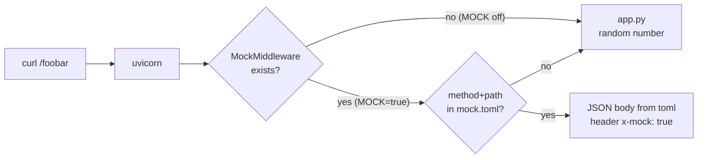

> Files moved: the Python side now lives in `python_mock/`: the customer files in `python_mock/test/`, the framework in `python_mock/src/asgi_mock/__init__.py`. Line numbers below refer to the files at the time of writing.

# Mock Flow Explained

How a request travels after `app.py` is defined, and where the `MOCK` switch takes effect.

## The big picture

`app.py` is never edited. Mocking happens by putting an object **in front of** the app, at startup, in `serve.py`.

```
                 MOCK unset/false                      MOCK=true
 curl ──► uvicorn ──► FastAPI app (app.py)     curl ──► uvicorn ──► MockMiddleware ──► FastAPI app
                                                                     │  (mock.py)
                                                                     └─ route in mock.toml? reply from toml
```



## Phase 1: startup (runs once)

`cd python_mock && uv run test/serve.py` (or `MOCK=true cd python_mock && uv run test/serve.py`)

1. **`serve.py:5`** `import mock`
   - `mock.py:8` reads `MOCK_FILE` env var once (default `mock.toml`). Only the file *path* is read here, not its contents.
2. **`serve.py:6`** `from app import app`
   - `app.py` builds the FastAPI object and registers `GET /foobar`. It has no idea mocking exists.
3. **`serve.py:9`** `asgi = mock.wrap(app, mocked_functions)`. **This is the only decision point.**
   - `mock.py:37-38` calls `enabled()` (`mock.py:11-12`), which checks that `MOCK` is exactly `true` (case-sensitive; `True`, `1` etc. mean real).
   - **MOCK on:** returns `MockMiddleware(app)`, a thin object that holds a reference to the real app.
   - **MOCK off:** returns the real `app` unchanged. Zero overhead, and the mock code never runs again.
4. **`serve.py:11`** `uvicorn.run(asgi, ...)` starts the server on `127.0.0.1:$PORT` (default 8000) and hands every request to `asgi`.

Because `MOCK` is checked only here, **flipping `MOCK` requires a server restart.** Editing `mock.toml` does not (see Phase 2).

## Phase 2: per request (MOCK=true)

Every HTTP request makes uvicorn call `MockMiddleware.__call__(scope, receive, send)` (`mock.py:25`). That's the ASGI interface: `scope` is a dict describing the request, and `send` is how you write the response.

1. **`mock.py:26`** Only `http` requests are considered. `lifespan` (startup/shutdown events) and `websocket` go straight to the real app.
2. **`mock.py:27`** `self._routes()` (`mock.py:20-23`) opens and parses `mock.toml` **fresh on every request** and builds a lookup dict:
   ```python
   {("GET", "/foobar"): {"method": "GET", "path": "/foobar", "handler": "foobar"}}
   ```
   Then it looks up `(scope["method"], scope["path"])`. Matching is **exact**: no path params, no query string (`/foobar?x=1` still matches `/foobar`, because `scope["path"]` excludes the query).
3. **Match found** (`mock.py:28-33`):
   - Calls `mocked_functions.<handler>(scope)` (here `foobar`) and serializes its return value to JSON. (`disabled = true` routes get a 500 instead, without consulting `mocked_functions.py`.)
   - Sends the status line + headers (`content-type: application/json`, `x-mock: true`).
   - Sends the body, then **returns**. The real app is never called, so `random` never runs.
4. **No match** (`mock.py:34`): `await self.app(scope, receive, send)` forwards the untouched request to FastAPI. That's why `/docs` and any unlisted endpoint still work normally.

## Phase 2: per request (MOCK off)

uvicorn calls FastAPI directly → routing → `foobar()` in `app.py` → `{"value": <random>}`. `mock.py` isn't involved at all.

## Worked example

```sh
MOCK=true PORT=8765 cd python_mock && uv run test/serve.py
curl -i localhost:8765/foobar
```

| Step | What happens |
|------|-------------|
| startup | `enabled()` → True → `asgi = MockMiddleware(app)` |
| request arrives | scope = `{type: "http", method: "GET", path: "/foobar", ...}` |
| `_routes()` | reads `mock.toml` → `{("GET","/foobar"): {...handler=foobar}}` |
| lookup | hit |
| response | `200`, `x-mock: true`, `{"value": 42}` |

Toml edits (adding or removing routes, flipping `disabled`) apply with **no restart**. Changing what `foobar()` returns is a code change in `mocked_functions.py`, so it needs a restart.

`curl localhost:8765/docs` → no toml entry → forwarded → normal Swagger page.

## Knobs summary

| Knob | Where | Read when | Restart needed? |
|------|-------|-----------|-----------------|
| `MOCK` | env | startup (`serve.py:8`) | yes |
| `MOCK_FILE` | env | import (`mock.py:8`) | yes |
| `PORT` | env | startup (`serve.py:11`) | yes |
| route `method`/`path`/`handler`/`disabled` | `mock.toml` | startup check + every request | no |
| what a mocked route returns | `mocked_functions.py` | import (code) | yes |

## How to tell a response is mocked

Check the `x-mock: true` response header (`curl -i`). Real responses never carry it.

## Why this design

- **No code change to the app:** the wrapper sits outside it, following the standard ASGI middleware pattern. Any FastAPI/Starlette app can be wrapped the same way, which covers the "apply to real APIs" goal for **incoming** routes.
- **Partial mocking:** only listed routes are faked, so you can mock one flaky endpoint and keep the rest real.
- **Known limits:** exact path match only, static bodies, re-parses toml per request (fine for dev, cache it if it ever matters). It does not intercept **outbound** calls your app makes to third-party APIs; that would need a hook in the HTTP client (e.g. an `httpx` transport), not this middleware.
